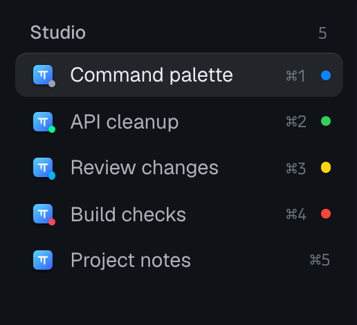

<h1 align="center">Tern Tab Status</h1>

> See which OMP and pi sessions are working, waiting, or need your attention in Tern's tab bar.

<p align="center">
  <a href="./README.md">English</a> · <a href="./README.zh-CN.md">简体中文</a>
</p>
<p align="center">
  <a href="#install">Install</a> · <a href="#try-it">Try it</a> ·
  <a href="#read-the-colors">Colors</a> · <a href="#limitations">Limitations</a>
</p>

<p align="center">
  
  <br>
  <sub>Historical session status demo in Tern 0.8.3.</sub>
</p>

When OMP and pi sessions run in different tabs or split panes, switching between them interrupts the work you are following. Tern Tab Status combines each tab's supported pane states into a right-side status dot in horizontal and vertical tabs. Agent icons stay side by side, tab titles stay yours, and neither agent needs a status hook or extension. Your chosen native tab color remains stored separately and appears when no status takes priority.

Selected native checks cover **Tern 0.8.3–0.8.4, OMP 18.11.0–18.11.1, and pi 1.1.0 on macOS arm64**. The final copied-source CSS run passes 13 of 14 cases, including working, completion, failure, viewed results, Pi confirmation, mixed-pane priority, both tab orientations and manual colors across Pause/Resume/reload. A production daily reload also shows Gmail's blue dot. The sole failed case is OMP standalone confirmation, which remains native idle and unsupported. The host timer-budget mechanism, full daily high-ID lifecycle and restoration of old large-ID color records remain limitations. See the [readiness record](./docs/readiness.md#current-css-cutover-evidence) for versions and evidence. Other platforms are unverified.

## Read the colors

| Dot | Meaning |
| --- | --- |
| Blue | An OMP or pi pane is working |
| Green | An unseen native result needs attention, usually after completion |
| Yellow | An OMP or pi pane reports `waiting_input` |
| Red | An unseen failure, error, or nonzero exit needs attention |
| Original color | No supported agent activity or attention; no dot if the tab had no color |

A tab combines its OMP and pi panes, in this priority order: **red → yellow → green → blue → original color**. A green dot means attention is pending, not that the task passed review.

## Install

You need Tern with its plugin CLI and OMP or pi available in its shell PATH. Git must be available for URL installation. The plugin has no runtime dependencies or build step. Node.js is only needed for development checks. If `tern` is not on your macOS PATH, use `/Applications/Tern.app/Contents/MacOS/tern` in its place.

### From GitHub

Tern can clone and install this plugin directly from GitHub:

```sh
tern plugin install https://github.com/yoyooyooo/tern-tab-status.git
tern plugin list --json
```

Confirm `tern-tab-status` is `ready` with no problem for this plugin. URL installation copies the plugin into Tern's plugin directory; you do not need to maintain a checkout. The equivalent GitHub shorthand is `tern plugin install github.com/yoyooyooo/tern-tab-status`.

<details>
<summary>Install from local source</summary>

From an extracted or cloned copy of this repository:

```sh
tern plugin link "$PWD"
tern plugin list --json
```

Run these commands at the repository root. The plugin list should contain `tern-tab-status` with `status: "ready"` and no problem for this plugin. A link loads files from this checkout; keep the directory in place.

For a copied installation that does not depend on the checkout location:

```sh
tern plugin install "$PWD"
```

For plugins in a repository subdirectory, Tern also accepts `github.com/OWNER/REPO/PATH`.

</details>

## Try it

1. Search `new` in the command palette, then choose **New OMP Tab** or **New Pi Tab** in the **Agents** group. Send a request, then switch to another tab. The first tab shows blue while it works.
2. Let the request finish. If Tern marks the pane as needing attention, the tab shows green.
3. Return to that pane, or use Tern's **Needs attention** view. Viewing its result restores the idle tab's original color.

With split panes, focusing one pane does not acknowledge the others. Input waits remain yellow until the agent leaves native `waiting`; working stays blue even when focused. Overlapping dots show the highest-priority state.

Results that arrive while their pane is focused are already viewed, so completion or failure reveals the native manual color immediately. Leaving the pane or reloading the plugin does not bring back that result's dot. The plugin persists per-pane read markers without clearing Tern's native attention; a later result that arrives while away can show green or red again. Read markers suppress only native `done`, `bell`, and `failed`, never `working` or `waiting`.

## Controls

The command palette includes:

- **New OMP Tab** (Agents): open an OMP Agent Block in a new tab at the current directory.
- **New Pi Tab** (Agents): open a pi Agent Block in a new tab at the current directory.
- **Tern Tab Status: Pause and Restore Tab Colors**: hide status styling, reveal native manual colors, and retry restoration of legacy saved colors.
- **Tern Tab Status: Resume**: enable status styling again.

The launch commands run `omp` and `pi` respectively, without an initial prompt. They preserve the configured default Agent command and placement, so the ordinary **New agent block** action continues to use both. Tern 0.8.3 requires briefly selecting the command and `new_tab` placement during synchronous creation; the plugin restores both preferences immediately, including when creation fails. Launching still works while status colors are paused.

Both commands appear in the command palette and can be assigned keys in Tern's Keyboard settings. Their action IDs are `plugin.tern-tab-status.new_omp_tab` and `plugin.tern-tab-status.new_pi_tab`.

The host module publishes full native pane IDs as strings when its roster changes, on shell lifecycle events and a 750 ms fallback poll. The window module uses those exact IDs to identify supported panes and build CSS targeting native `.tn-dk-c[data-pane][data-st]` elements. Native state changes drive the dot directly, without production `agents:list()` polling or writing status into `tab.color`. Direct `omp`/`pi` executable basenames are recognized; shell-hosted OMP uses a bounded `omp.session` descriptor query (one node, depth one, 128 characters). Window start, pane/tab, command, directory and title events synchronize identification and shared pause directly; focus and completion events update persisted read markers. The timer supplements those events rather than dispatching them. Paused refreshes skip identification. Manual colors remain real native tab colors throughout work, Pause, Resume and reload.

### Update or uninstall

For a linked installation, update the source and run `tern plugin reload`. For a copied installation, repeat the original `tern plugin install` command with `--force`. A GitHub installation updates with `tern plugin install https://github.com/yoyooyooo/tern-tab-status.git --force`; a local copy updates with `tern plugin install "$PWD" --force` from the updated source directory. Updates are manual. `--force` replaces copied installations only; to replace a linked installation with a copy, pause, unlink, then install.

Before disabling, unlinking, or removing the plugin, run **Pause and Restore Tab Colors** to hide status styling and retry any legacy restoration. Then use the command for your installation:

```sh
tern plugin unlink tern-tab-status
# For a copied installation instead:
tern plugin remove tern-tab-status
```

Pause is persisted. Run **Resume** after reinstalling if status dots remain paused. Enabled state, pane IDs and read markers live in Tern's `plugin-data/tern-tab-status/kv.json` under its configuration directory. Unlinking does not erase that state. Older versions also saved original/applied tab colors. On upgrade, restoration writes the saved original only if the current native color still equals the old applied color, and clears that record only after observing successful restoration. A different current color is preserved and its obsolete record is discarded. Large-ID SDK color failures can leave matching old records unresolved; this does not block the new status dot.

## Limitations

- One dot shows only the highest-priority state. Use **Needs attention** and individual panes for details.
- Green/red follow native `done`/`bell`/`failed` state with the plugin's per-pane read markers. Focused results remain read across leaving and reload; the plugin does not count unread messages or clear native attention.
- Green covers unseen native attention generally; it is not a separate record of successful completion. A completion already viewed may never show green.
- OMP and pi are recognized by executable basename; shell-hosted OMP additionally supports the bounded `omp.session` fallback. Use **New Pi Tab** or a pi Agent Block for native pi status. Ordinary-shell pi and custom wrapper names have no verified status contract. pi 1.1.0 reports through OSC 7501; older versions are unverified.
- Exact native pane strings avoid the SDK's low-44-bit color-addressing path for status display. A controlled window on the existing daemon passed 12 real OMP/pi lifecycle observations with native IDs above `2^44`: work, unseen completion/failure, viewing, read persistence across reload and Pi waiting/dismissal. Selected daily panes also resolve and show blue; these samples do not establish universal compatibility. The SDK limitation still affects upgrade restoration of old tab-color records. See the [evidence and limits](./docs/readiness.md#current-css-cutover-evidence).
- CSS depends on Tern's native tab markup and `data-st` vocabulary, verified in selected Tern 0.8.4 scenarios. Future markup changes can require an update. This exact-pane CSS differs from the rejected historical title-marker experiment and works in both tab orientations within the observed scope.
- Tern can disable a plugin VM's timers after a callback exceeds its 50 ms wall-clock budget, including native waiting or descheduling. The captured daily failure was in the removed synchronous `cx.agents:list()` path. Native CSS state changes no longer require that poll; lifecycle events now synchronize directly without waiting for a timer callback. Timer loss can still delay changes with no delivered lifecycle event, including cross-window pause in a quiet window. The host mechanism is not repaired. See the [known native blockers](./docs/readiness.md#known-native-blockers).
- OMP 18.11.0–18.11.1 standalone extension commands using `ctx.ui.confirm` can show a real blocking dialog while Tern still reports `idle`; this remains observed on Tern 0.8.4. That path does not produce yellow and remains unsupported. Pi's blocking confirmation reports `waiting_input` and displays yellow, including while focused; cancellation reveals the native manual color. Ordinary model/session pickers do not all report waits. Yellow follows native `waiting` rendering.
- Very brief native states can be missed by an observer. Pause is shared through plugin storage; other windows apply it on their next refresh. No window means no window-plugin synchronization.

## Privacy

The plugin reads native pane IDs, pane metadata, a bounded surface descriptor for shell-hosted OMP identification, legacy tab-color records, and the default Agent command and placement. It installs local CSS and writes its own local key/value state. Status display does not write tab colors; only upgrade restoration may call the native color API. Explicit launch commands ask Tern to start `omp` or `pi` and temporarily select then restore both preferences. It makes no network requests, installs no agent extension, and does not store conversation text. See [SECURITY.md](./SECURITY.md) for reporting and trust boundaries.

## Development

Node.js 22 or later and npm are required for checks:

```sh
npm ci --ignore-scripts
npm run check
```

This compiles and executes the actual host/window Luau modules using a pinned development-only Luau runtime, checks identification, CSS priority, read state, legacy restoration and launch behavior, and validates local documentation links and the plugin manifest. It does not replace live Tern acceptance.

For native verification from this checkout:

```sh
node scripts/verify-native.mjs --doctor
node scripts/verify-native.mjs --case launch
node scripts/verify-native.mjs
```

The doctor checks prerequisites without opening Tern. The launch case exercises both command-palette launchers. The full run uses an isolated native window, daemon, and offline model provider with real OMP and pi processes. Status assertions use screenshot pixels (`statusColor`); native `tab.color` remains the independent check for manual colors. PNG decoding uses Node's built-in zlib, with no added dependency. Confirmation fixtures identify themselves as automated checks requiring no user action; the runner allows five seconds for native waiting, records unsupported paths as failures, and sends Escape to close dialogs. Each run retains `summary.json`, snapshots, screenshots, and process cleanup evidence in its printed output directory. The [verification skill](./.cursor/skills/verify-tern-tab-status/SKILL.md) and [feature map](./.cursor/skills/verify-tern-tab-status/features/README.md) describe prerequisites, navigation, expected results, and evidence.

See [CONTRIBUTING.md](./CONTRIBUTING.md) for architecture and manual acceptance steps, [CHANGELOG.md](./CHANGELOG.md) for changes, and [the readiness record](./docs/readiness.md) for verification scope. The npm manifest is private development tooling; installation uses Tern, not npm.

Report bugs and discuss contributions in [GitHub Issues](https://github.com/yoyooyooo/tern-tab-status/issues). Report vulnerabilities privately through [GitHub Security Advisories](https://github.com/yoyooyooo/tern-tab-status/security/advisories/new).

## License

[MIT](./LICENSE). This is an independent plugin, not an official Tern, OMP, or pi project.
